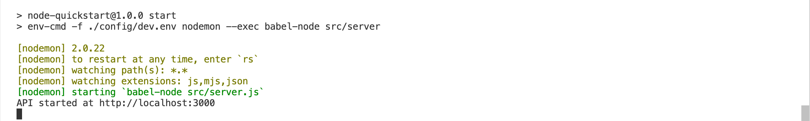
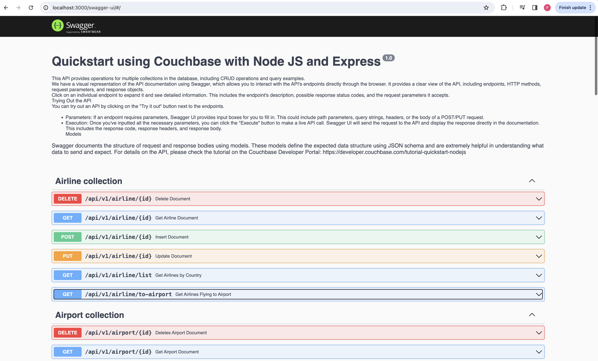
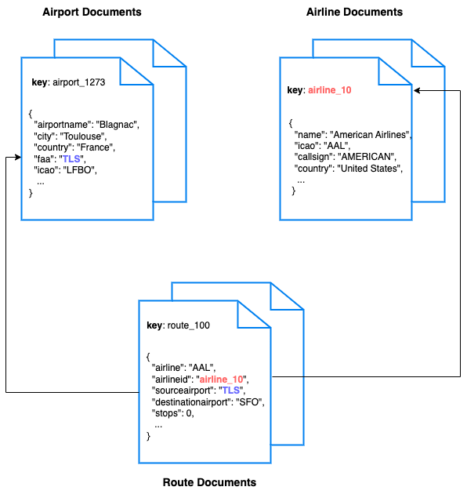

# Quickstart in Couchbase with Node JS and Express

#### Build a REST API with Node JS and Express

Often, the first step developers do after creating their database is to create a REST API that can perform Create, Read, Update, and Delete (CRUD) operations for that database. This repo is designed to teach you and give you a starter project (in Node JS using Express) to generate such a REST API. After you have installed travel-sample bucket in your database, you can run this application which is a REST API with Swagger documentation so that you can learn:

1. How to create, read, update, and delete documents using [Key Value operations](https://docs.couchbase.com/nodejs-sdk/current/howtos/kv-operations.html) (KV operations). KV operations are unique to couchbase and provide super fast (think microseconds) queries.
2. How to write simple parametrized [SQL++ queries](https://docs.couchbase.com/nodejs-sdk/current/howtos/n1ql-queries-with-sdk.html) using the built-in travel-sample bucket.

Full documentation for the tutorial can be found on the [Couchbase Developer Portal](https://developer.couchbase.com/tutorial-quickstart-nodejs).


If you are looking for a quickstart using [Ottoman](https://ottomanjs.com/), you can find it in this [repo](https://github.com/couchbase-examples/ottomanjs-quickstart).


## Prerequisites

To run this prebuilt project, you will need:

- [Couchbase Capella](https://www.couchbase.com/products/capella/) cluster with [travel-sample](https://docs.couchbase.com/python-sdk/current/ref/travel-app-data-model.html) bucket loaded.
  - To run this tutorial against a local Couchbase Server instead, follow [Running Against a Local Couchbase Server](#running-against-a-local-couchbase-server).
- [LTS Node.js Version](https://nodejs.org/en/download) installed on local machine (Node.js 24 recommended; the Babel 8 toolchain requires `^22.18.0` or `>=24.11.0`).
- Basic knowledge of [JavaScript](https://developer.mozilla.org/en-US/docs/Learn/Getting_started_with_the_web/JavaScript_basics), [Node JS](https://nodejs.org/en/learn/getting-started/introduction-to-nodejs) and [Express](https://expressjs.com/)
- Loading Travel Sample Bucket
  If travel-sample is not loaded in your Capella cluster, you can load it by following the instructions for your Capella Cluster:
  - [Load travel-sample bucket in Couchbase Capella](https://docs.couchbase.com/cloud/clusters/data-service/import-data-documents.html#import-sample-data)

## Similar Quickstart Repositories

This quickstart examples demonstrates creating REST API using NodeJS, however,  quickstart is also available in following flavors and variants of javascript:

[TypeScript REST API quickstart](https://github.com/couchbase-examples/typescript-quickstart.git)

[Next.js REST API quickstart](https://github.com/couchbase-examples/nextjs-capella-quickstart)

[Ottoman quickstart](https://github.com/couchbase-examples/ottomanjs-quickstart) (Couchbase node based ODM - learn more [Ottoman](https://ottomanjs.com/) here)

## App Setup

We will walk through the different steps required to get the application running.

### Cloning Repo

```shell
git clone https://github.com/couchbase-examples/nodejs-quickstart.git
```
## Install Dependencies

Any dependencies will be installed by running the npm install command, which installs any dependencies required for the project.

```sh
# Execute this command in the project's root directory
npm install
```

### Setup Database Configuration

> Using a local Couchbase Server instead of Capella? Skip to [Running Against a Local Couchbase Server](#running-against-a-local-couchbase-server).

To know more about connecting to your Capella cluster, please follow the [instructions](https://docs.couchbase.com/cloud/get-started/connect.html).

Specifically, you need to do the following:

- Create the [database credentials](https://docs.couchbase.com/cloud/clusters/manage-database-users.html) to access the travel-sample bucket (Read and Write) used in the application.
- [Allow access](https://docs.couchbase.com/cloud/clusters/allow-ip-address.html) to the Cluster from the IP on which the application is running.

All configuration for communication with the database is read from the environment variables. We have provided convenience env templates in the `config` folder for both local app runs and the Jest suite.

```sh
cp config/dev.env.example config/dev.env
cp config/test.env.example config/test.env
```

Then update `config/dev.env` and `config/test.env` with your cluster details:

```sh
DB_CONN_STR=<connection_string>
DB_USERNAME=<user_with_read_write_permission_to_travel-sample_bucket>
DB_PASSWORD=<password_for_user>
DB_BUCKET_NAME=travel-sample
APP_PORT=3000
```

> Note: The connection string expects the `couchbases://` or `couchbase://` part.

| Variable | Required | Description | Local Couchbase Server value |
| --- | --- | --- | --- |
| `DB_CONN_STR` | Yes | Couchbase connection string. Use `couchbases://` for Capella (TLS) and `couchbase://` for a local server. | `couchbase://localhost` |
| `DB_USERNAME` | Yes | Database user with read and write access to the bucket. | `Administrator` |
| `DB_PASSWORD` | Yes | Password for `DB_USERNAME`. | `password` |
| `DB_BUCKET_NAME` | Yes | Bucket that holds the sample data. The app expects the `inventory` scope inside it. | `travel-sample` |
| `APP_PORT` | Yes | Port the Express server listens on. | `3000` |

`npm start` reads `config/dev.env` and `npm test` reads `config/test.env`. If one of the `DB_*` variables is missing, the app fails on startup with `Please define the <NAME> environment variable inside dev.env`.

### Running Against a Local Couchbase Server

These steps run Couchbase Server in Docker on your machine. You can use a Couchbase Server you installed natively instead: start at step 2 and use its host, username, and password.

1. Start Couchbase Server:

   ```sh
   docker run -d --name couchbase \
     -p 8091-8097:8091-8097 -p 11210-11211:11210-11211 \
     couchbase/server:enterprise
   ```

   Wait until http://localhost:8091 shows the Couchbase Server setup page (this takes about 30 seconds).

2. Initialize the cluster with the Data, Query, and Index services. The app needs all three: Data for key-value operations, and Query plus Index for the SQL++ list endpoints.

   ```sh
   docker exec couchbase couchbase-cli cluster-init -c localhost \
     --cluster-username Administrator --cluster-password password \
     --services data,index,query \
     --cluster-ramsize 1024 --cluster-index-ramsize 256 \
     --index-storage-setting default
   ```

   You can also do this in the web console at http://localhost:8091 by choosing **Setup New Cluster**.

3. Load the `travel-sample` bucket. This also creates the indexes the SQL++ queries use.

   ```sh
   curl -u Administrator:password -X POST http://localhost:8091/sampleBuckets/install \
     -d '["travel-sample"]'
   ```

   In the web console, this is **Settings > Sample Buckets > travel-sample > Load Sample Data**. Loading takes about a minute.

4. Check that the bucket, scope, and collections the app uses exist:

   ```sh
   curl -s -u Administrator:password \
     http://localhost:8091/pools/default/buckets/travel-sample/scopes \
     | grep -o '"name":"inventory"'
   ```

   This prints `"name":"inventory"` once loading has finished. The app reads and writes these keyspaces:

   | Bucket | Scope | Collections |
   | --- | --- | --- |
   | `travel-sample` | `inventory` | `airline`, `airport`, `route` |

5. Create the env files and point them at the local server:

   ```sh
   cp config/dev.env.example config/dev.env
   cp config/test.env.example config/test.env
   ```

   Set the same values in both `config/dev.env` and `config/test.env`:

   ```sh
   DB_CONN_STR=couchbase://localhost
   DB_USERNAME=Administrator
   DB_PASSWORD=password
   DB_BUCKET_NAME=travel-sample
   APP_PORT=3000
   ```

   > Note: Local Couchbase Server uses `couchbase://` (no `s`). `couchbases://` requires TLS and fails against a default local install.

6. Start the app with `npm start`, then [verify it](#verifying-the-application).

These are local development credentials only. Don't reuse them for a shared or production cluster.

## Running The Application

### Directly on machine

At this point, we have installed the dependencies, loaded the travel-sample data and configured the application with the credentials. The application is now ready and you can run it.

The application will run on port 3000 of your local machine (http://localhost:3000). You will find the Swagger documentation of the API.

```sh
# Execute this command in the project's root directory
npm start
```

### Using Docker

- Build the Docker image

```sh
# Execute this command in the project's root directory
docker build -t couchbase-node-express-js-quickstart .
```

- Run the Docker image

```sh
# Execute this command in the project's root directory
docker run -it --env-file config/dev.env -p 3000:3000 couchbase-node-express-js-quickstart
```

> Note: The `dev.env` file in the `config` folder has the connection information to connect to your Capella cluster. These will be part of the environment variables in the Docker container.

> Note: Inside the app container, `localhost` refers to the container itself, not your machine. If Couchbase Server runs on your machine, set `DB_CONN_STR=couchbase://host.docker.internal` for the Docker run (on Linux, also add `--add-host=host.docker.internal:host-gateway` to `docker run`).

### Verifying the Application

Once the application starts, you can see the details of the application on the terminal.



The application will run on port 3000 of your local machine (http://localhost:3000). You will find the interactive Swagger documentation of the API if you go to the URL in your browser. Swagger documentation is used in this demo to showcase the different API end points and how they can be invoked. More details on the Swagger documentation can be found in the [appendix](#swagger-documentation).



The `API started` log line only means Express is listening. The app connects to Couchbase on the first request, so check that it can read data:

```sh
curl -i http://localhost:3000/api/v1/airline/airline_10
```

A working setup returns `HTTP/1.1 200 OK` with this document:

```json
{"id":10,"type":"airline","name":"40-Mile Air","iata":"Q5","icao":"MLA","callsign":"MILE-AIR","country":"United States"}
```

To check SQL++ queries too (these need the Query and Index services):

```sh
curl "http://localhost:3000/api/v1/airport/list?country=United%20Kingdom&limit=2"
```

This returns a JSON array of two airports.

If the check fails:

- The request hangs or times out: the app can't reach Couchbase. Check `DB_CONN_STR`, and that Couchbase Server is running.
- `HTTP 500` with `AuthenticationFailureError: authentication failure`: check `DB_USERNAME` and `DB_PASSWORD`.
- `404` with `document not found`: `travel-sample` isn't loaded, or it is still loading.
- The list endpoint returns an error but the airline lookup works: the Query or Index service isn't enabled on the cluster, or the travel-sample indexes are still building.


## Running The Tests

To run the integration tests, use the following commands:

```sh
# Execute this command in the project's root directory
npm test
```

## Appendix
### Data Model

For this quickstart, we use three collections, `airport`, `airline` and `route` in the `inventory` scope of the `travel-sample` bucket. They contain sample airports, airlines and airline routes respectively. The `route` collection connects the airports and airlines as seen in the figure below. We use these connections in the quickstart to generate airports that are directly connected and airlines connecting to a destination airport. Note that these are just examples to highlight how you can use SQL++ queries to join the collections.



### Extending API by Adding New Entity

If you would like to add another entity to the APIs, these are the steps to follow:

- **Create the New Entity in Couchbase Bucket:**
  - Utilize the [Couchbase Server interface](https://docs.couchbase.com/cloud/n1ql/n1ql-language-reference/createcollection.html) to establish the new collection within the Couchbase bucket.

- **Define the New Route:**
  - Navigate to the `src/routes` folder and create the new route.

- **Controller Configuration:**
  - Develop a new file in the `controllers` folder, mirroring the existing structures (e.g., `airportController.js`). Craft the corresponding method within this file to manage the new entity.


- **Add Tests:**
  - Add the tests for the new routes in a new file in the `__test__` folder similar to other collection tests.

Following these steps ensures a systematic and organized approach to expanding the API functionality with a new entity.
### Running Self Managed Couchbase Cluster

For step-by-step instructions, see [Running Against a Local Couchbase Server](#running-against-a-local-couchbase-server). For a self-managed cluster on another host, [load](https://docs.couchbase.com/server/current/manage/manage-settings/install-sample-buckets.html) the travel-sample data bucket and [create a user](https://docs.couchbase.com/server/current/manage/manage-security/manage-users-and-roles.html#add-a-user) with read and write access to it. Then set `DB_CONN_STR`, `DB_USERNAME`, and `DB_PASSWORD` in `config/dev.env` to point at that cluster.

> Note: Couchbase Server must be installed and running prior to running this app.

### Swagger Documentation

Swagger documentation provides a clear view of the API including endpoints, HTTP methods, request parameters, and response objects.

Click on an individual endpoint to expand it and see detailed information. This includes the endpoint's description, possible response status codes, and the request parameters it accepts.

#### Trying Out the API

You can try out an API by clicking on the "Try it out" button next to the endpoints.

- Parameters: If an endpoint requires parameters, Swagger UI provides input boxes for you to fill in. This could include path parameters, query strings, headers, or the body of a POST/PUT request.

- Execution: Once you've inputted all the necessary parameters, you can click the "Execute" button to make a live API call. Swagger UI will send the request to the API and display the response directly in the documentation. This includes the response code, response headers, and response body.

#### Models

Swagger documents the structure of request and response bodies using models. These models define the expected data structure using JSON schema and are extremely helpful in understanding what data to send and expect.